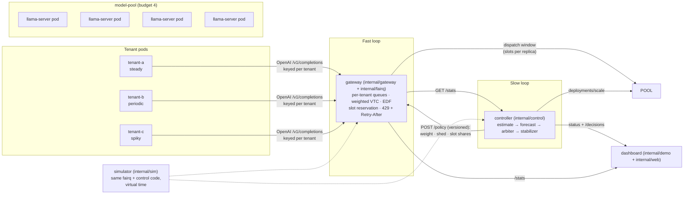

# TenantScaler

**Per-tenant guaranteed shares for a shared LLM replica pool: an autoscaler that decides _whose_ requests get the scarce replicas, coupled to a token-fair gateway. It runs on one PC, in Kubernetes, from one command.**

Several teams share one LLM served by one fixed pool of replicas, and each team has a latency SLO. When one team's traffic spikes, the others miss their SLO although their own traffic never changed: the *noisy neighbour*. Per-workload autoscalers such as HPA and KEDA can grow the pool, but they cannot decide whose requests the replicas serve. Once the budget is reached, everyone degrades together.

TenantScaler runs two coupled loops:

- **Slow loop: the controller, every 10 s.** It estimates each tenant's demand from its weighted token rate (input + 2 × output tokens), optionally raised by a Holt-Winters forecast. It **arbitrates** the fixed budget: guaranteed shares first, idle shares lent out, reclaimed when the owner returns. It stabilises the pool size (up fast, down slow, bounded steps) and resizes the pool. It pushes a versioned **policy** to the gateway: per-tenant weight, shedding flag, slot shares and Retry-After. Every decision is recorded with a plain-English reason.
- **Fast loop: the gateway, per request.** It keeps per-tenant queues ordered by a token-fair virtual counter (VTC with counter lift), with critical > standard > sheddable classes and EDF within a tenant, plus a critical quota. It reserves slot shares, so a borrower cannot hold the slots a guaranteed tenant needs: requests are never preempted. Over-share sheddable traffic gets **HTTP 429 with a jittered Retry-After**, but only while the pool is contended.

## Run it

You need **Docker**, **kind**, **kubectl** and **Go 1.27**. Nothing else, and no account anywhere.

```powershell
./scripts/up.ps1
```

```bash
./scripts/up.sh
```

That one command creates the kind cluster, builds the image, downloads the model once (~400 MB, SHA-256 pinned) and copies it onto the node, generates a key file outside the repository, installs the CRD and the Secret, applies everything, and waits for the rollout. Then open **http://127.0.0.1:8080**.

It is safe to run again: an existing cluster, key file and model are reused, and only the image and manifests are refreshed.

```powershell
./scripts/up.ps1 -Simulated   # no model, no 309 MB image pull; latencies simulated and labelled
./scripts/up.ps1 -Recreate    # throw the cluster away and build it again
./scripts/down.ps1            # delete the cluster
```

What ends up running, all in the cluster, all on this PC:

| Pod | What it is |
|---|---|
| `model-pool` | The replicas the controller scales, 1 to 4 of them. Each is a `llama-server` container (official llama.cpp image b11913) serving Qwen2.5-0.5B-Instruct Q4_K_M on 2 CPUs. |
| `gateway` | The token-fair gateway every request passes through. Finds ready replicas through EndpointSlices. |
| `tenantscaler-controller` | The arbiter. One cycle every 10 s, writing each decision into the tenant's `TenantScaler` status. |
| `dashboard` | Watches the two above and serves the page you open. Starts nothing and sits outside the data path. |
| `tenant-a`, `tenant-b`, `tenant-c` | Three load generators: steady, periodic, and spiky. |

Three node ports are mapped to localhost, and to localhost only:

| URL | What |
|---|---|
| http://127.0.0.1:8080 | the dashboard |
| http://127.0.0.1:8081 | the gateway (needs a tenant key) |
| http://127.0.0.1:18090/decisions | the controller's reasoning, as JSON |

## What you are looking at

Tenant **c** spikes for 40 s every 2 minutes, by itself, forever. Each time it does:

```bash
kubectl -n tenantscaler get tenantscalers -w     # Grant / Demand / Shedding, per tenant
kubectl -n tenantscaler logs -f deployment/tenant-c
curl -s 127.0.0.1:18090/decisions | python -m json.tool | head -40
```

c's grant rises to its cap of 3 as it borrows the replica a and b are not using; then its demand passes what exists, the arbiter marks it **shedding**, and the gateway answers its sheddable requests with 429 and a Retry-After. a's and b's guaranteed replica is never lent out from under them, so their time-to-first-token stays near its SLO while c's own traffic is the thing that gets trimmed. When the spike subsides the loan is reclaimed and shedding stops.

The controller explains every one of those moves in words, which is the point of the decision log: *"c got 2 replicas: guarantee 1 plus 1 borrowed; it wanted more, so its sheddable requests get 429."*

To drive a tenant yourself instead, scale its pod to zero and take its place:

```bash
kubectl -n tenantscaler scale deployment/tenant-c --replicas=0
```

```powershell
bin/tenantscaler.exe loadgen -gateway http://127.0.0.1:8081 -key <c's key> -profile spike -spike-now
```

The key file is `%UserProfile%\.tenantscaler\kind.env` (`~/.tenantscaler/kind.env`). Keys are never printed by the scripts. The gateway decides which tenant a request belongs to **from its key**, so a client cannot claim to be another tenant by setting the fairness header, and c's key is capped at the *sheddable* class so c cannot jump the queue by asking for *critical*.

## What is real and what is not

This distinction is load-bearing, so it is marked in the code, on the dashboard badge and here.

- **REAL.** Inference in the cluster is real. Each replica is a `llama-server` process serving a real 0.5B model, and TTFT, TPOT, cold start and throughput are measured, not modelled. The controller really scales a Deployment through `deployments/scale`; the gateway really follows pods through EndpointSlices; decisions really land in `TenantScaler` status.
- **NOT COMPARABLE with bare metal.** The pods are *not* CPU-pinned and they run inside the kind node's container. The measurements the SLOs were derived from used one `llama-server` per physical P-core on bare metal. Latencies here are real but softer, and the two sets of numbers must not be put in one table.
- **SIMULATED, and labelled as such.** `-Simulated` swaps the replicas for a latency model calibrated against the real replica (within 25% at concurrency 1–5). The 10-setup sweep, the cold-start sweep and the forecaster study also run in a discrete-event simulator — one that executes the *same* gateway scheduler, controller and arbiter code in virtual time, with only replica compute replaced.

`replicaCapacityTokensPerSec: 117` in `deploy/k8s/15-config.yaml` is a bare-metal measurement carried over as a starting value. On a different machine, re-measure it:

```powershell
./scripts/setup-llama.ps1                                  # llama-server + the model, for host-side runs
bin/tenantscaler.exe profile -config config/real.yaml      # TTFT/TPOT/throughput, and the capacity C
```

## Architecture



| Package | Role |
|---|---|
| `internal/arbiter` | Who gets the scarce replicas: guarantees, borrowing of idle shares, reclaim, over-promise check (property-tested) |
| `internal/estimate`, `internal/stabilize`, `internal/forecast` | Demand from token rate, SLO slack, HPA-style stabilisation, Holt-Winters with a trust gate |
| `internal/control` | One control cycle (pure, clock-agnostic); policy and explained decision records; fail-static on missing metrics |
| `internal/fairq`, `internal/gateway` | Fair scheduler (VTC, EDF, critical quota, slot reservation, shedding) and the HTTP gateway (`/v1/completions`, `/policy`, `/stats`, `/metrics`) |
| `internal/controller` | Live runner: metrics sources (gateway `/stats`, Prometheus), actuators, policy publisher, decision log |
| `internal/llama`, `internal/pool`, `internal/replica`, `internal/engine` | Real `llama-server` replicas (CPU-pinned, killed with their parent) or simulated ones |
| `internal/k8s`, `deploy/` | The `TenantScaler` CRD, the actuator on a Deployment's `/scale`, EndpointSlice discovery, RBAC, KEDA/HPA baselines, the image |
| `internal/stack`, `internal/realrun`, `internal/loadgen` | One live stack per setup; evaluation on real replicas; trace replay |
| `internal/sim`, `internal/experiment`, `internal/eval` | Discrete-event simulator, simulated sweep, metrics with 95% CIs, SVG plots |
| `internal/demo`, `internal/web` | The dashboard: sequential A/B, or observing a cluster |

### How the cluster is wired

- **One config, four readers.** `deploy/k8s/15-config.yaml` is mounted by the gateway, the controller, the simulated replicas and the dashboard. An earlier version gave the gateway a config of its own and left the controller on built-in defaults, with a test pinning the two together; one file removes that class of bug outright. A `slotsPerReplica` the gateway honoured but the controller did not know about would make the controller's critical slot reservation disagree with the gateway's dispatch window.
- **The controller owns `spec.replicas`.** Neither `10-model-pool.yaml` sets it, so re-applying a manifest never resets the pool size.
- **The tenant list has one source.** The gateway reads its tenants from the `TenantScaler` resources and falls back to the config file; `internal/k8s` tests fail if the file and the resources disagree.
- **Restricted Pod Security everywhere.** Non-root UID 65532, read-only root filesystem, all capabilities dropped, no service-account token where none is needed. Tests check the fields rather than trusting the YAML.
- **Scale-down is graceful.** A `preStop` sleep keeps a pod serving while its endpoint turns not-ready and the gateway's discovery drops it; only then does SIGTERM drain what is in flight, inside the grace period.
- **The controller fails static.** A cycle whose gateway stats or Deployment status cannot be read scales nothing, records the error in `/status`, and counts it in `tenantscaler_controller_failstatic_total`.

## Measure and evaluate

The dashboard shows one run, which is one sample. The numbers worth quoting come from these, each of which prints its options with `-h`:

| Command | What it does |
|---|---|
| `tenantscaler experiment -runs 10 -out results/sim/default` | SIMULATED: all setups, cold-start sweep 10/30/60/120 s, forecaster evaluation. Includes S4, the Flow-Control-equivalent baseline, which is the one worth comparing against. |
| `tenantscaler realrun -config config/real.yaml -runs 5` | REAL, host-side: S2/S3/S5/S7 on pinned `llama-server` processes, one setup at a time, mean ± 95% CI. About 1.5 h. |
| `tenantscaler profile -config config/real.yaml` | REAL, host-side: drives one replica at concurrency 1..6; reports TTFT/TPOT/throughput, the capacity C, and checks the simulated engine's calibration against it. |
| `tenantscaler loadgen`, `baseline` | Replay a scenario against any OpenAI-compatible endpoint; run a KEDA/HPA baseline on a pool. |
| `tenantscaler config -config <file>` | Validate a config. It rejects guarantees that exceed the budget. |
| `python scripts/measure-capacity.py` | REAL, in-cluster: the replica capacity C that `15-config.yaml` needs, read from each `llama-server`'s own token counters at a range of pool sizes. Run this on any new machine before trusting a latency from it. |

`results/` is generated output and is **not committed** — a fresh clone has none, and the commands above are how you get it. In-cluster baselines live in `deploy/k8s/baselines/`: each replaces the TenantScaler controller on the same pool, which is what the simulated setups S1 and S2 are. They need the passthrough gateway, because a fair gateway holds the backlog in its own queue and a queue-based autoscaler would never see it:

```bash
kubectl apply -f deploy/k8s/baselines/gateway-passthrough.yaml
kubectl apply -f deploy/k8s/baselines/keda-scaledobject.yaml   # needs KEDA installed
kubectl apply -f deploy/k8s/20-gateway.yaml                    # back to TenantScaler
```

Heavy steps can be wrapped in `python scripts/dev/heavy.py --timeout <s> -- <command>`, which takes a cross-process lock, runs a RAM/VRAM/CPU/temperature guard, and caps parallelism.

## Local dashboard, without Kubernetes

The dashboard also runs a sequential A/B by itself, replaying the same 120 s trace first on a queue-based KEDA baseline and then on TenantScaler, each with the full budget and the same seed:

```powershell
./scripts/setup-llama.ps1     # once: llama.cpp b11898 + the model, SHA-256 pinned
./scripts/run-demo.ps1        # open http://127.0.0.1:8080 and press "Run A/B"
```

This is the only path that CPU-pins each replica to its own physical core, so it is the one whose latencies compare with `results/real/`. Ctrl+C stops it and kills every replica it started; `tenantscaler cleanup` clears up after a crash.

## Test

```powershell
./scripts/lint.ps1    # gofmt, go vet, node --check on the dashboard JS, py_compile on the guard scripts
./scripts/test.ps1    # unit tests (go test -p 4), then test/e2e with one worker
```

The `internal/k8s` tests are worth knowing about: they parse every manifest under `deploy/`, and fail if two files define the same object without declaring it an overlay, if the gateway's tenants drift from the `TenantScaler` resources, if a pod stops meeting restricted Pod Security, if a Service forwards to a port its Deployment does not listen on, or if a baseline's bounds stop matching the pool budget. The end-to-end tests start the real binary, drive a full A/B through its HTTP API, and stop every process by PID.

## Status

Unit tests, `go vet` and `./scripts/lint.ps1` pass. Every manifest, the new ones included, is decoded into its typed Go struct with strict field validation — the same rules the API server applies, so a misspelled, wrongly cased or misplaced field fails the build rather than the deploy. Verified by hand too: the three PowerShell scripts parse, `scripts/keys.ps1` writes a key file in the LF, no-BOM shape `kubectl --from-env-file` needs, and the gateway starts on the cluster's own config with those keys (`config OK: pool "shared-llm-pool" capacity 4 replicas, 3 tenants`, then `tenantKeys=3 adminKey=true`, dispatch window 2 per replica). The model is downloaded and its SHA-256 matches the pin.

The cluster runs. `./scripts/up.ps1` goes from nothing to a working stack and exits 0, with all ten pods ready and the dashboard answering 200 on `http://127.0.0.1:8080` under the badge **KUBERNETES: REAL llama.cpp replicas**. Everything below came out of that cluster, not the simulator.

Arbitration, with the controller's own wording. During c's spike:

```
Pool: grants add up to 4, desired 4 of 4, applying 4.
  c got 1 replica: its guarantee of 1; no spare capacity was left to borrow.
    It wanted 11, so its sheddable requests get 429 until capacity frees up.
  b got 2 replicas: guarantee 1 plus 1 borrowed, its full demand.
```

c was offering 1008 weighted tokens/s and 59.1 were admitted, with 50 requests shed; its own tenant pod logged `answered 11  429 64`. The same moment seen through the resources, which is the claim in one line — the noisy tenant is the only one shed, and the quiet ones keep what they were promised:

```
NAME   POOL              GUARANTEED   MAX   GRANT   DEMAND   SHEDDING
a      shared-llm-pool   1            3     1       1        false
b      shared-llm-pool   1            3     1       1        false
c      shared-llm-pool   1            3     2       4        true
```

When c and b went quiet instead, the log reads *"its guarantee of 1 is free for others to borrow until it needs it back"*, and the stabiliser held the pool up rather than collapsing it: *"desired 1 of 4, applying 4. Scale-down waits for demand to stay low for 60s."* Over 80 cycles there was no fail-static.

**`replicaCapacityTokensPerSec` was wrong here, and is now measured.** The committed 117 came from bare metal with one CPU-pinned `llama-server` per physical P-core. These pods are neither pinned nor on bare metal, and the first runs showed it: in a cycle where the pool had been sized to 3, tenant a reached a p99 TTFT of 7.3 s against its 2 s SLO. Measured on this cluster with `python scripts/measure-capacity.py --levels 1,2,4 --window 90`, which reads each `llama-server`'s own token counters while one tenant offers more than the pool can serve:

| replicas | aggregate weighted tokens/s | per replica |
|---|---|---|
| 1 | 100.7 | 100.7 |
| 2 | 165.7 | 82.9 |
| 4 | 241.5 | **60.4** |

So C is 60, not 117 — the controller had been crediting each replica with nearly twice the throughput it has, and under-sizing the pool accordingly. The curve also says something the bare-metal numbers cannot: replicas here keep only 0.60 of their single-replica rate at a budget of 4, against 0.86 on bare metal, so adding pods on one PC buys considerably less than adding pinned processes does.

With C corrected the pool holds at its full budget of 4 rather than stopping at 3, and tenant a's p99 TTFT drops from 7.3 s to roughly 1–2.5 s with attainment often at 100%. Individual 15-second windows still vary, and some show misses for all three tenants at once — these are short windows on a laptop, not the repeated interleaved runs that `experiment` and `realrun` exist for, so treat them as evidence the calibration was the problem, not as an SLO result.

If Docker Desktop will not start, see the first entry under *When something is wrong* in `RUNBOOK.md`.

## Configuration

`deploy/k8s/15-config.yaml` is what the cluster runs on. `config/real.yaml` is the host-side real-inference configuration: a budget of 4 CPU-pinned replicas, tenants A/B/C guaranteed 1 each, TTFT p99 ≤ 2 s and TPOT p99 ≤ 200 ms (`docs/DESIGN.md` §20). `config/live-demo.yaml` is the same with C at priority 50. `tenantscaler config -print` shows the built-in default, a 10-replica GPU-like pool the simulator uses.

| Variable | Used by | Meaning |
|---|---|---|
| `TS_LLAMA_SERVER`, `TS_LLAMA_MODEL` | `demo`, `profile`, `realrun`, `pool -backend llama` | Paths to `llama-server` and the GGUF; empty = simulated engine |
| `TS_CACHE_DIR` | `scripts/setup-llama.ps1` | Download cache (default `.cache/`) |
| `TS_DEMO_ADDR` | `demo` | Dashboard listen address (default `127.0.0.1:8080`) |
| `TS_API_KEY` | `loadgen -gateway` | A tenant's key, so it stays out of shell history |
| `TS_ADMIN_KEY` | `gateway`, `controller`, `demo -observe-gateway` | The gateway's admin endpoints |
| `TS_OBSERVE_REPLICAS` | `demo -observe-gateway` | `simulated` or `llama`, for the dashboard badge |
| `TS_UPSTREAM_ENDPOINTS`, `TS_UPSTREAM_API_KEY` | `gateway` | Static upstream discovery, instead of Kubernetes |
| `TS_KUBECONFIG`, `TS_NAMESPACE` | `controller`, `gateway` | Kubernetes mode; empty = in-cluster |

Copy `.env.example` to `.env` to set them for host-side runs. `.env` is git-ignored, and real environment variables win over it. The cluster takes its secrets from the Secret, never from `.env`.

## Credits

Qwen2.5-0.5B-Instruct (Apache-2.0) and llama.cpp (MIT) carry their own licences. The dashboard's headings use the Bangers font by Vernon Adams (SIL OFL 1.1), self-hosted with its licence; its charts, tables and decoration are hand-written, so it ships no third-party JavaScript. Visual inspiration: Era Namjoshi's portfolio, via Site of Sites.
